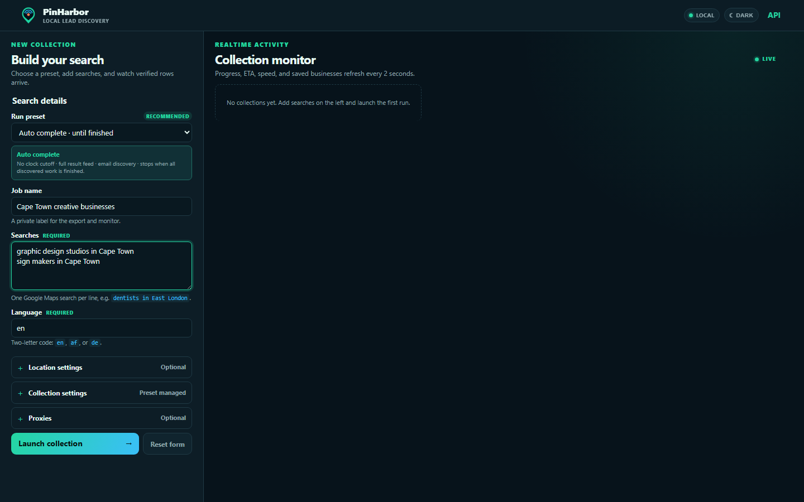
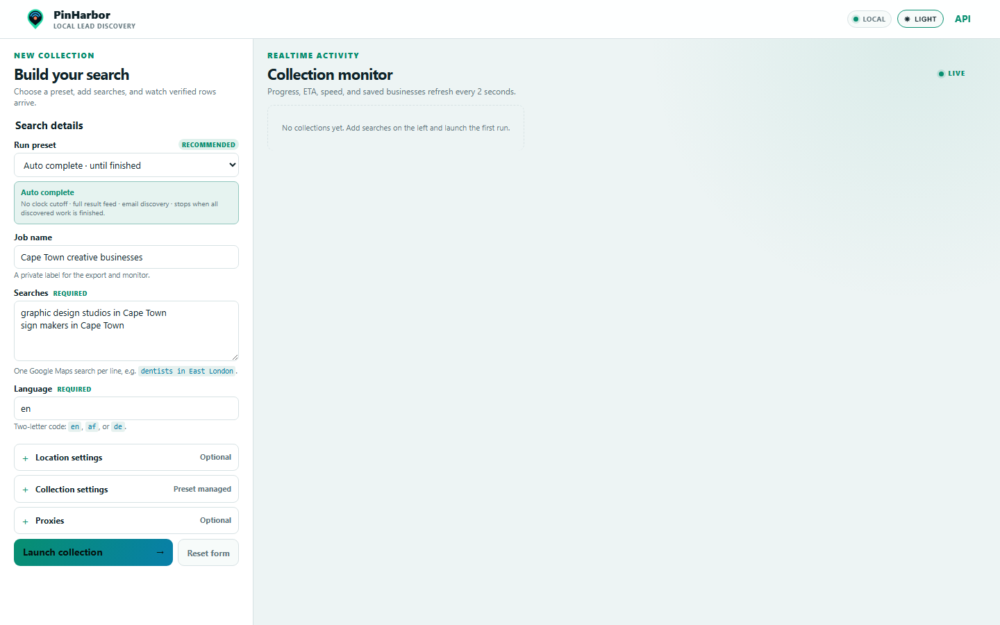

<div align="center">
  
  <h1>PinHarbor</h1>
  <p><strong>Local lead discovery with a clear finish line.</strong></p>
  <p>A Windows-first Google Maps business collector with a compact live monitor, completion-driven Auto Mode, and private local CSV storage.</p>

  [](https://github.com/YazeKT/PinHarbor/actions/workflows/ci.yml)
  [](https://github.com/YazeKT/PinHarbor/actions/workflows/codeql.yml)
  [](go.mod)
  [](#quick-start)
  [](LICENSE)
</div>

---



## Why PinHarbor

PinHarbor turns Google Maps searches into focused business lists without hiding the work behind a vague spinner. It shows real saved rows, discovered and completed tasks, speed, elapsed time, and an estimated finish while it runs.

- **Completion-driven by default** — Auto Mode keeps collecting until the result feed ends and all discovered enrichment work finishes.
- **Truthful realtime monitoring** — progress comes from actual work counters and flushed CSV rows.
- **Private local workflow** — job data and exports stay under `webdata/` on your computer.
- **Partial-result recovery** — stop a run without discarding rows already written.
- **Purpose-built exports** — every CSV follows one stable six-column contract.
- **Readable in both themes** — dark mode is the default, with a persistent light-mode option.
- **No Docker or WSL required** — the supported Windows launcher builds, prepares, opens, and supervises the app.

## Quick start

### Requirements

- Windows 10 or 11
- [Go](https://go.dev/dl/) matching the version declared in `go.mod`
- Internet access for the first-run Playwright Chromium download and collection requests

### Run

1. Download or clone this repository.
2. Double-click **`Run PinHarbor.bat`**.

The launcher builds the current source, installs the browser engine on first use, waits for the health check, opens `http://localhost:8080`, and restarts the local server after an unexpected exit. Keep its terminal window open while using PinHarbor.

> [!IMPORTANT]
> `webdata/` contains your private jobs and exports. Back it up while PinHarbor is stopped, and never commit or share it accidentally.

## Typical workflow

1. Leave **Auto complete** selected.
2. Give the run a private job name.
3. Add one Google Maps search per line.
4. Select **Launch collection**.
5. Watch verified rows arrive in the realtime monitor.
6. Download the finished CSV, or use **Stop & keep partial** when you have enough results.

**Reset form** only restores the input defaults. It does not stop jobs, remove exports, or delete saved data.

## Run presets

| Preset | Stop condition | Depth | Email discovery | Extra reviews |
| --- | --- | ---: | :---: | :---: |
| **Auto complete** | Every discovered task completes | Until feed ends | Yes | No |
| Quick scan | 15-minute cap | 25 | No | No |
| Balanced | 1-hour cap | 100 | Yes | No |
| Deep collection | 3-hour cap | 250 | Yes | Yes |
| Custom | Operator-defined | Operator-defined | Operator-defined | Operator-defined |

Preset policy is applied on the server. Disabled browser fields or stale tabs cannot silently change a managed preset.

## CSV contract

Exports always contain these columns in this exact order:

```text
title,address,phone,complete_address,about,emails
```

`complete_address` and `about` are JSON strings inside their CSV cells. Multiple email addresses are comma-separated.

## Realtime monitor

The HTMX monitor refreshes every two seconds and reports:

- rows already flushed to disk;
- completed and discovered search/place work;
- results per minute;
- elapsed time and estimated completion;
- the latest saved businesses;
- whether a finished download is complete or partial.

Discovered work can grow during collection, so early percentages and estimates may move. Active runs stay below 100%; completed runs show 100% only after the worker is truly finished.

<details>
<summary><strong>Light theme preview</strong></summary>



</details>

## Local endpoints

| Endpoint | Purpose |
| --- | --- |
| `/` | PinHarbor interface |
| `/health` | Local readiness and server time |
| `/jobs` | Realtime HTMX job cards |
| `/stop` | Stop a UI job and retain its partial CSV |
| `/api/docs` | Interactive OpenAPI reference |
| `/api/v1/jobs` | Local job API |

The server listens on port `8080` without authentication. Do not port-forward it or expose it publicly without a separate security review and an authenticated reverse proxy.

## Architecture

```text
Browser form
    | POST /scrape
    v
Web handlers -> preset policy -> SQLite job queue
                                      |
                                      v
                           Go/Playwright worker
                                      |
                   exact counters + resilient CSV writer
                                      |
                                      v
                         HTMX monitor every 2 seconds
```

The Go process owns SQLite and CSV access. Browser code communicates through HTTP/HTMX routes and never receives direct filesystem access.

## Documentation

| Guide | What it covers |
| --- | --- |
| [Documentation index](docs/README.md) | Start here for maintained product docs |
| [Architecture](docs/ARCHITECTURE.md) | Package boundaries, lifecycle, and data flow |
| [Auto Mode](docs/AUTO-MODE.md) | Presets and completion semantics |
| [Operations](docs/OPERATIONS.md) | Startup, backup, health checks, and recovery |
| [Local API](docs/API.md) | Endpoints, statuses, and request example |
| [Testing](docs/TESTING.md) | Automated and browser verification |
| [Brand](docs/BRAND.md) | Name, logo, palette, and theme rules |
| [Security](SECURITY.md) | Local threat model and private reporting |
| [Legal and responsible use](LEGAL.md) | Operator obligations and important limitations |

## Development

```powershell
go test ./...
go vet ./...
git diff --check
```

Run `gofmt -w <changed-go-files>` before committing Go changes. The upstream module path remains `github.com/gosom/google-maps-scraper` intentionally; changing it requires a planned migration.

## Privacy and responsible use

PinHarbor stores jobs and results locally, but collection necessarily contacts Google Maps and—when email discovery is enabled—public business websites. Publicly visible data is not automatically unrestricted data. You are responsible for applicable laws, website terms, outreach rules, retention, security, and deletion obligations. Read [LEGAL.md](LEGAL.md) before using collected data.

PinHarbor is an independent project and is not affiliated with, endorsed by, or sponsored by Google.

## Origin, ownership, and license

PinHarbor is a customized derivative of [gosom/google-maps-scraper](https://github.com/gosom/google-maps-scraper). Georgios Komninos and upstream contributors retain ownership of their work. Kirsten Trimaley owns the original PinHarbor branding, Windows-local workflow, monitor experience, presets, documentation, and other PinHarbor-specific modifications created by her.

The software is distributed under the [MIT License](LICENSE). See [NOTICE.md](NOTICE.md) for attribution and [THIRD-PARTY-NOTICES.md](THIRD-PARTY-NOTICES.md) for dependency guidance. The MIT license grants software rights; it does not grant permission to imply endorsement or pass off another product as PinHarbor.

## Contributing and support

Read [CONTRIBUTING.md](CONTRIBUTING.md) before proposing a change. For usage help, see [SUPPORT.md](SUPPORT.md). Security-sensitive reports belong in GitHub's private vulnerability reporting channel, as described in [SECURITY.md](SECURITY.md).

---

<div align="center">
  <strong>PinHarbor</strong><br>
  <sub>Collect locally. See the work. Keep the result.</sub>
</div>
